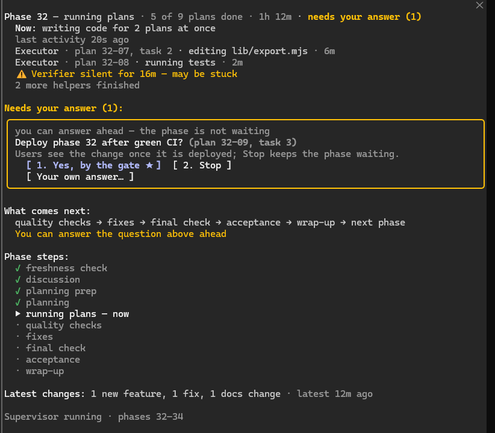

<div align="center">

# gsd-turbo

**Run a whole [GSD](https://github.com/open-gsd/gsd-core) milestone in the background with Claude Code — and get asked only when it really needs you.**

[](https://github.com/rnyqdz99yx-afk/gsd-turbo/actions/workflows/ci.yml)
[](https://github.com/rnyqdz99yx-afk/gsd-turbo/tags)
[](LICENSE)


English · [Русский](README.ru.md)



</div>

> [!WARNING]
> **Beta.** gsd-turbo is young and has been run for real on one project, on Windows. Background sessions work **without asking for permission** (`bypassPermissions`) and use your Claude plan's limits noticeably faster than plain GSD. Read [Before you start](#before-you-start).

## What it does

`/gsd-autonomous` runs your milestone inside one Claude Code session: it stops when the context fills up, waits for you at every decision and runs the full test suite again and again. gsd-turbo hands the milestone to a small supervisor process instead:

| | Plain GSD | gsd-turbo |
|---|---|---|
| Where a phase runs | in your session | in a background session; you can close yours |
| Context limit | you `/clear` and start again | a fresh session picks up at the same step |
| Decisions | asks you each time | takes the recommended option and records it |
| A plan's checkpoints | wait for you at the stop | clickable questions you can answer **ahead**, in the session, the pane or Telegram |
| Quality gates | one after another | in parallel |
| Tests | the full suite after each wave | only the tests your change touches; one full run per phase |
| `human_needed` checks | all yours | browser and HTTP checks run by the `turbo-uat` agent; only owner-only items are left |
| Next phase | you start it | starts by itself |

## How it works

```text
turbo-run supervisor (plain Node, no LLM)
 ├─ phase N  → background Claude Code session running /turbo-phase
 │              freshness → discuss → plan → execute → gates ∥ → fixes → full tests → UAT → done
 ├─ context full?  → new session resumes at the same step
 ├─ needs you?     → a question card in your session, the pane, Telegram; a desktop notification
 └─ phase done     → push + CI (optional) → next phase
```

It never modifies GSD itself: it talks to GSD only through `gsd-tools` and GSD's own skills, agents and workflows.

## Quick start

You need Node.js ≥ 20, git, Claude Code ≥ 2.1.290 and GSD core 1.16.x or 1.17.x (`npx @opengsd/gsd-core@1.17`).

```bash
# 1. Install (copies files into ~/.claude; --dry-run shows what it would do)
git clone https://github.com/rnyqdz99yx-afk/gsd-turbo && cd gsd-turbo && node install.mjs

# 2. Open your GSD project once and accept the trust prompt
cd /path/to/your-gsd-project && claude
```

```text
# 3. In that Claude Code session
/turbo-autonomous
```

That's it. The run shows up on the right of any Claude Code session in the project (type `/turbo-view` if your window is too narrow for the pane). You can close the session: the supervisor keeps going and sends a desktop notification when it needs you or the milestone is done.

| Command | What it does |
|---|---|
| `/turbo-autonomous` | start the rest of the milestone (`--only N`, `--from N --to M`, `--all`) |
| `/turbo-autonomous status` | what runs now and what waits for you |
| `/turbo-autonomous answer` | answer the open questions |
| `/turbo-autonomous away` | answer ahead everything that can be, then leave; `back` shows what happened |
| `/turbo-autonomous attend N` | run the rest of phase N here with you (for plans that need a device, a login…) |
| `/turbo-autonomous stop` | stop the supervisor and its sessions |
| `/turbo-adopt` | move a milestone already running on plain GSD onto turbo: where it stands, the closed phases turbo skips, all questions at once, one commit; then `/turbo-autonomous` ([details](docs/reference.md#adopting-a-running-milestone)) |

## Before you start

- **Permissions.** Background sessions run with `--permission-mode bypassPermissions` so nobody has to approve tool calls. Your Claude Code hooks still apply. For a stricter first run, set `lane_permission_mode` in `.planning/turbo/config.json` ([config](docs/reference.md#config)).
- **Usage.** Phases run on your model in the background with parallel helpers and automated UAT. Expect to hit your plan's limits faster than with plain GSD.
- **GSD version.** Tested with GSD core 1.16.x and 1.17.x. With another version `turbo-run doctor` drops to a safe mode, or refuses to start if GSD changed incompatibly.
- **What stays yours.** Signatures, your accounts on third-party sites, physical devices, 2FA, money. The run does everything else first, then stops and asks. A safe question you leave open for an hour (a plan's recommended choice, a check its automated evidence decides) is taken by turbo itself and notified, with an undo command ([which ones](docs/reference.md#owner-questions)).
- **Safety rails.** No force-push, no rewriting published history, no data deletion without a dry run, no overwriting a running executable. Details in [Safety](docs/reference.md#safety).
- **Uninstall** with `node install.mjs --uninstall` ([what to check first](docs/reference.md#uninstall)).

## Optional extras

- **Telegram** — get the questions and answer them with buttons away from the computer ([setup](docs/reference.md#telegram-optional)).
- **Push and CI** — the supervisor pushes and watches GitHub Actions; a red run goes back to the phase to fix ([setup](docs/reference.md#push-and-ci-optional)).
- **Targeted tests** — set up by `turbo-run init` when a full test command is known ([how it decides](docs/reference.md#what-happens)).
- **Autostart after a reboot** — `turbo-run autostart on` brings this project's supervisor back at logon when a run was going; `off` removes it ([what it sets up](docs/reference.md#after-a-crash-or-a-reboot)).
- **Lean mode** — on by default (`lean.enabled`): leaner GSD settings, less effort for GSD's planner and the lane sessions, a STATE.md budget; `turbo-run lean status` shows it, `turbo-run lean off` restores GSD's settings ([what it changes](docs/reference.md#lean-mode)).
- **Build path (v0.6)** — `build.enabled: true` runs eligible phases by code: parallel slices in their own worktrees, short headless sessions per role, the same GSD files ([how](docs/reference.md#build-path-turbo-run-build)).

## Troubleshooting

**After a crash or a reboot.** Come back to your chat with `claude -r` (pick it by its title) or `claude --resume <id>`: `/turbo-autonomous status` prints that line with the id. A bare `claude -c` opens the latest conversation in the folder, which in checkout mode may be a lane's own. The turbo pane comes back by itself. Unless autostart is on, start the supervisor again with `/turbo-autonomous`: lanes whose sessions died with the machine go on where they stopped ([details](docs/reference.md#after-a-crash-or-a-reboot)). A supervisor that dies without a word while you are away is told to you once, on the desktop and in Telegram, by the turbo pane in your session or by a running lane. If the crash left the supervisor's state file damaged, the pane and `/turbo-autonomous status` say so, and `/turbo-autonomous` keeps the file aside and rebuilds the lanes from the slots and their sessions, saying what it recovered and what not.

## Documentation

The [full reference](docs/reference.md) covers every command, the config, owner questions, live sittings, automated UAT, the GSD settings turbo writes and recovery. Design specs are in [docs/specs](docs/specs).

## Roadmap

1. ✅ **Core** — supervisor, automatic continuation, targeted tests, safe mode.
2. ✅ **Faster phases** — `/turbo-phase` with a parallel prologue, gates in parallel, `turbo-uat`.
3. ✅ **The owner in the loop** — question cards answered ahead (session, pane, Telegram), push and CI, the live view, live sittings.
4. ✅ **Parallel phases** — `/turbo-plan-milestone`: every future phase prepared ahead at once; several phases running side by side with shared-resource locks and merging.
5. ✅ **Adoption** — `/turbo-adopt`: plug turbo into a milestone that is already in progress — where it stands, what was skipped, all questions up front, a plan for the rest.
6. **Lean turbo** — ✅ the lean GSD profile: no gates that catch nothing, less thinking and reading, one fixer pass, one full test run per phase, `turbo-run cost` *(v0.5.x, current)*; the build path: code conducts the phase, and each plan starts in its own short session as soon as the plans it needs are merged *(v0.6, in progress)*.

## License

MIT, see [LICENSE](LICENSE). gsd-turbo is an overlay for [GSD](https://github.com/open-gsd/gsd-core) (MIT); it does not copy or modify GSD files.
